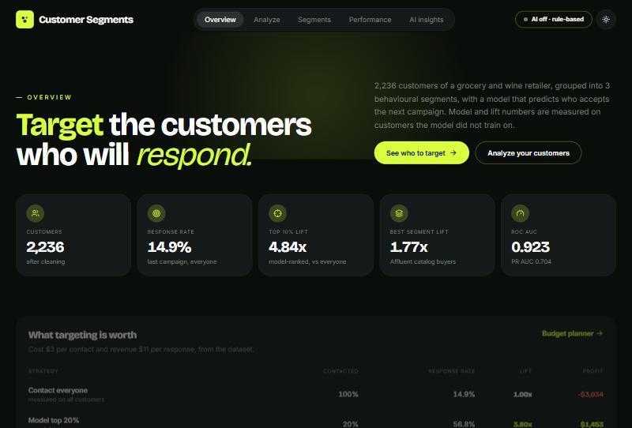
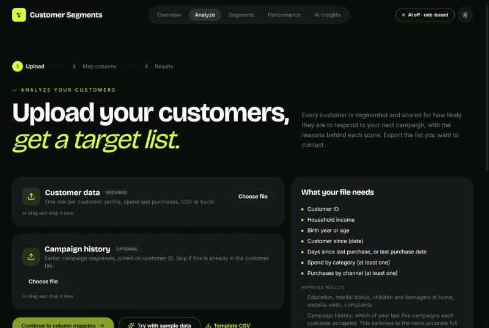
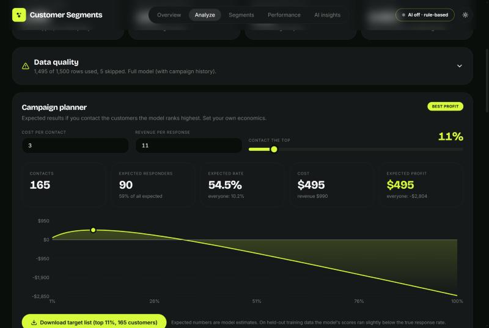
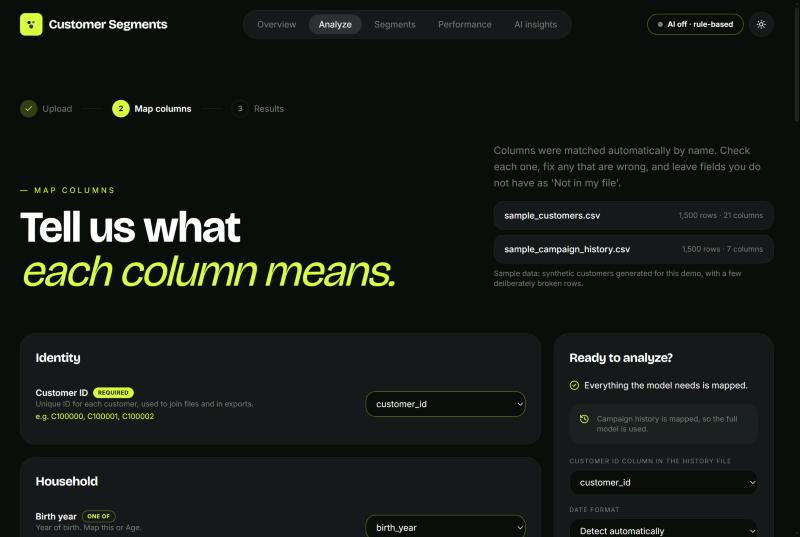
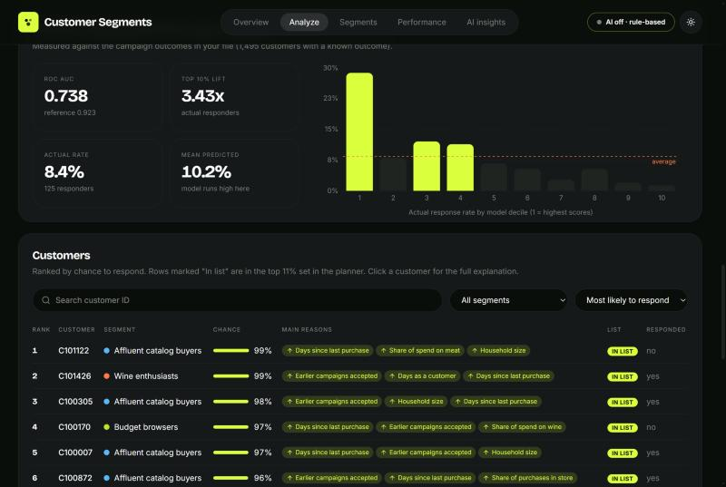
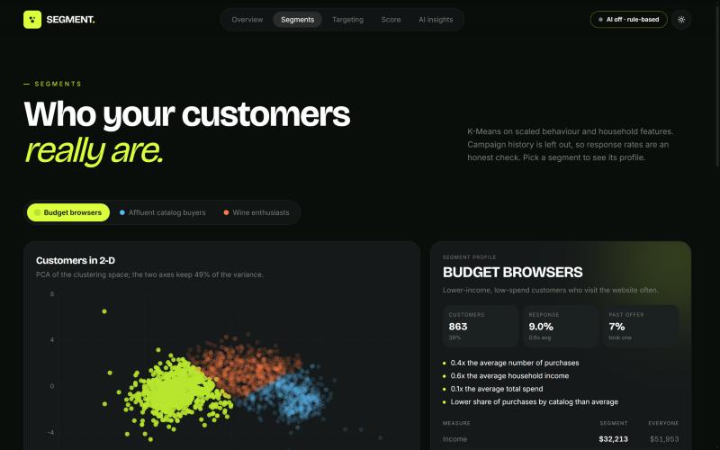
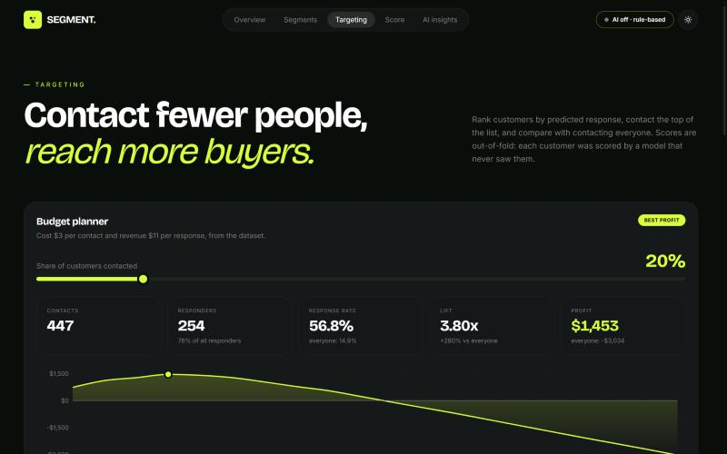
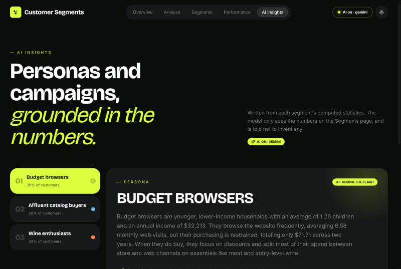
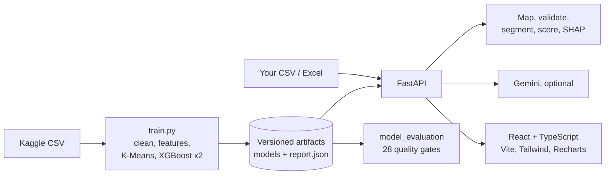

# Customer Segmentation and Campaign Targeting

Upload a retail customer list and get back segments, a ranked target list for your next campaign, the reasons behind every score, and the expected profit of contacting the top of the list.

Recreated on public data: the models are trained on the Kaggle [Customer Personality Analysis](https://www.kaggle.com/datasets/imakash3011/customer-personality-analysis) dataset (2,236 customers of a grocery and wine retailer). It rebuilds, with a stronger evaluation, a segmentation project I did during a data science internship whose original code is no longer available.



## The business problem

Mass campaigns are wasteful. In this dataset only 14.9% of customers accepted the last offer; at a $3 cost per contact and $11 revenue per response, contacting everyone loses money. The questions this app answers:

- Who are our customers, in a few groups a marketer can act on?
- Who is most likely to respond to the next campaign, and why?
- How many people should we contact to make the most money?

## What it does

- **Analyze your own customers.** Upload a CSV or Excel file (plus an optional campaign-history file joined on customer ID). Columns are matched automatically, you confirm the mapping, and invalid rows are reported with reasons rather than silently dropped.
- **Two models, chosen automatically.** With campaign history the full model is used; without it a behaviour-only model, so customers are never scored as if they had refused every offer.
- **Campaign planner.** Set your own cost per contact and revenue per response; the app finds the most profitable cut-off and exports that target list as CSV.
- **Explanations.** Every score comes with its top reasons (SHAP), and each customer has a detail view.
- **Checks on your data.** A data-quality panel flags rows skipped, defaults used and values outside the training range. If your file includes who responded to your latest campaign, the app measures how well it would have ranked them.
- **AI layer, optional.** With a Gemini key, the app writes segment personas and a campaign brief from the computed numbers. Without one, everything still works with rule-based text.

| Upload and map | Plan and export |
| --- | --- |
|  |  |
|  |  |

## Results

All numbers come from a real run on the Kaggle data. The full evaluation, with code, is in [model_evaluation/REPORT.md](model_evaluation/REPORT.md).

| Measure | Result |
| --- | --- |
| Holdout ROC AUC, full model | 0.923 (95% CI 0.884 to 0.954) |
| Holdout PR AUC, full model | 0.704 (base rate 0.150) |
| 5-fold CV ROC AUC | 0.923 ± 0.012 |
| Holdout ROC AUC, behaviour-only model | 0.893 (PR AUC 0.621) |
| Response lift in the top 10% (out-of-fold) | 4.84x |
| Profit, contacting the top 20% vs everyone | $1,453 vs a $3,034 loss |
| Lift from targeting the best segment alone | 1.77x on held-out customers |
| Quality gates passed | 27 of 28 (the failure: single-customer scoring latency, 72.6 ms at p95 vs a 50 ms gate; the API itself serves whole files) |

The evaluation covers leakage (label shuffling), robustness to noise, directional checks, SHAP additivity, segment stability across seeds and subsamples, performance by customer group, and a benchmark against logistic regression, random forest, gradient boosting and two no-model business rules.

| Segments | Model performance |
| --- | --- |
|  |  |



## Which data works

The models learned from one retailer, so they work best on similar data: consumer retail customers, one row per customer, spend by category and purchases by channel, and responses to direct-marketing offers. They are not meant for business-to-business, subscription, banking or insurance data, or for any decision with legal effect. The app shows this guidance on the upload page and flags uploads that look unlike the training data.

## Architecture



- `customer_segmentation/` Python package: data cleaning, feature engineering, segmentation, response models, SHAP, batch analysis, LLM layer and the API.
- `frontend/` React + TypeScript app built with Vite, Tailwind, Recharts and Motion.
- `model_evaluation/` the evaluation suite and its report.
- `artifacts/` the trained models, committed so the app runs without downloading the dataset.

## Run it

Requirements: Python 3.12 and Node 22.

```bash
python -m venv .venv
.venv/Scripts/pip install -r requirements-dev.txt   # macOS/Linux: .venv/bin/pip
cd frontend && npm ci && npm run build && cd ..
.venv/Scripts/python -m uvicorn customer_segmentation.api.main:app --port 8000
```

Open http://127.0.0.1:8000. The API serves the built web app, and the trained models in `artifacts/` are loaded at startup. Click **Try with sample data** on the Analyze page to see the full flow.

For frontend development with hot reload, run `npm run dev` in `frontend/` and open http://localhost:5173 (it proxies `/api` to port 8000).

### Optional: AI-written text

Copy `.env.example` to `.env` and set `GEMINI_API_KEY`. `LLM_MODEL` chooses the model. Without a key the app uses rule-based text everywhere.

### Retrain and re-evaluate

Download `marketing_campaign.csv` from Kaggle into `data/raw/`, then:

```bash
.venv/Scripts/python -m customer_segmentation.train
.venv/Scripts/python -m model_evaluation.run_all
```

## Tests

```bash
.venv/Scripts/python -m pytest --cov=customer_segmentation   # unit and API tests, synthetic data
.venv/Scripts/python -m pytest model_evaluation              # quality gates on the real data
```

CI runs ruff, the tests with a 90% coverage floor, and the frontend lint and build.

## License

MIT
